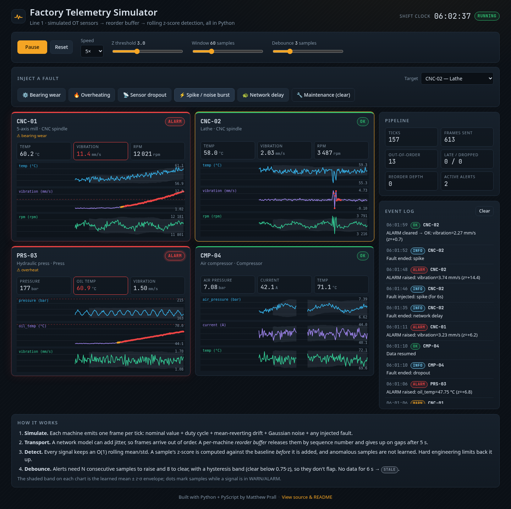

# Factory Telemetry Simulator

**Live demo:** <https://mjprall.github.io/factory-telemetry-sim/>

[](https://github.com/mjprall/factory-telemetry-sim/actions/workflows/tests.yml)

A small, fully static web app that simulates a factory line and does live
anomaly detection on its sensor data. It's written in Python and runs in the
browser through [PyScript](https://pyscript.net) (Pyodide/WebAssembly). There's
no backend: any static host can serve it.



**What you can do in the demo**

- Watch four machines on "Line 1" stream telemetry: two CNC spindles
  (temperature, vibration, spindle RPM), a hydraulic press (pressure, oil temp,
  vibration) and an air compressor (air pressure, motor current, temperature).
- Inject faults into any machine: **bearing wear** (vibration ramps up and
  accelerates), **overheating** (temperature drift), **sensor dropout**
  (the gateway goes quiet, so the tile shows STALE), **spike/noise burst**, and
  **network delay** (random latency causes out-of-order frames, which a
  reorder buffer puts back in order). **Maintenance** clears faults and
  re-learns the baselines.
- Tune detection while it runs: z-score threshold, rolling window size, and
  debounce count. You can also start/pause (or press Space), change the speed,
  and reset.
- Read the machine status tiles (OK / WARN / ALARM / STALE), the
  timestamped event log, and the pipeline counters (frames, out-of-order,
  late/skipped, reorder-buffer depth).
- Click **View source & README** in the footer. The page fetches and shows the
  same Python files it is running.

## How it works

```
Machine.emit()  ──►  Network  ──►  ReorderBuffer  ──►  SignalDetector  ──►  status tiles / event log / charts
 (sensor model)     (jitter)      (per machine,        (rolling z-score,
                                   by sequence no.)     hysteresis, debounce)
```

| File | Role |
|---|---|
| `sim.py` | **The core.** Pure Python, standard library only, no browser imports. Machine models, fault injection, network model, reorder buffer, rolling statistics, detection, and the `Plant` orchestrator. |
| `charts.py` | Pure chart geometry. It turns samples into SVG path strings, scales axes, and breaks lines at data gaps. |
| `app.py` | The only browser-specific module. It builds the DOM, wires controls, runs the async main loop, and paints canvases. Each series goes to `Path2D` as one SVG path string, so a series costs one JS call instead of hundreds of `lineTo` calls. |
| `index.html`, `styles.css` | Layout and dark industrial theme. PyScript is pinned to **2026.7.3**. |
| `pyscript.toml` | Tells PyScript to load `sim.py` and `charts.py` into the in-browser filesystem. |
| `tools/browser_smoke_test.py` | Optional Playwright/headless-Chrome end-to-end check. |
| `tests/` | pytest suite for `sim.py` and `charts.py`. It runs on plain CPython. |

**Signal model.** Each reading is built as
`nominal + duty-cycle sine + mean-reverting random walk + Gaussian noise + fault offset`.
One tick is one simulated second. At 1× speed the sim runs 2 ticks per real
second.

**Detection, per signal:**

1. `RollingStats` keeps a fixed-window mean and standard deviation in O(1) per
   sample. It uses Welford's update plus its inverse for the sample leaving
   the window. The naive sum/sum-of-squares method suffers catastrophic
   cancellation at 12,000 rpm ± 25.
2. Each sample is scored against the baseline *before* it is added:
   `z = (x − μ) / max(σ, floor)`. The σ floor avoids dividing by zero when a
   signal is flat. Scoring is skipped during warm-up (20 samples).
3. **The baseline only learns from normal-looking samples.** A plain rolling
   z-score absorbs a slow ramp: with a full window, z levels off around 1.7
   (window/√12 effect). That means a plain detector would never alarm on
   bearing wear. Freezing the baseline while a signal looks anomalous fixes
   this. A unit test covers this case.
4. **Hard engineering limits** (for example vibration ≥ 7.1 mm/s, roughly the
   ISO 10816 "unacceptable" zone) raise ALARM regardless of statistics. This
   is defense in depth.
5. **Hysteresis and debounce.** WARN is raised at |z| ≥ threshold and ALARM at
   1.6 × threshold. Once a signal is raised, the bar to stay raised drops to
   0.75 × the threshold. Raising takes N consecutive samples (the slider) and
   clearing takes 8, so alerts don't flap.
6. **STALE.** If no frames have arrived from a machine for 6 s, its tile shows
   STALE, which overrides OK/WARN/ALARM. No data means no verdict.

**Transport.** When a network-delay fault is active, each frame gets 0–4 s of
random latency. The `ReorderBuffer` releases frames strictly by sequence
number. If a gap isn't filled within 5 s it gives up on the missing frames and
counts them as *skipped*. Anything that arrives after its slot has passed is
counted as *late* and dropped. This keeps the detector seeing data in
measurement order.

## Run locally

PyScript needs the files served over HTTP. Opening `index.html` from `file://`
won't work.

From the repository root:

```bash
python3 -m http.server 8000
# open http://localhost:8000
```

Run the tests on plain CPython. No browser is needed.

```bash
python3 -m pip install pytest      # or: pip install -r requirements-dev.txt
python3 -m pytest -v
```

Optional browser smoke test. It drives headless Chrome with Playwright,
clicks the fault buttons, checks the console for errors, and refreshes
`screenshots/`.

```bash
pip install playwright && python3 tools/browser_smoke_test.py http://localhost:8765/
```

## Deploy to GitHub Pages

This repository publishes a project site at
<https://mjprall.github.io/factory-telemetry-sim/>.

[`.github/workflows/pages.yml`](.github/workflows/pages.yml) runs on every push
to `main`, and when started by hand with **workflow_dispatch**:

1. The pytest suite runs on Python 3.11, 3.12, and 3.13.
2. The site is deployed only if those tests pass. The Pages artifact contains
   the files the page needs at runtime: `index.html`, `styles.css`, `app.py`,
   `sim.py`, `charts.py`, `pyscript.toml`, `README.md` (the in-page **View
   source & README** dialog fetches it), and `.nojekyll`. `tests/`, `tools/`,
   `screenshots/`, and other dev files stay in the repository and are not
   published.

Every path the page requests is relative (`./styles.css`, `./app.py`,
`./pyscript.toml`, and `./sim.py` / `./charts.py` / `./README.md` fetched from
the page), so the same files work under the `/factory-telemetry-sim/` subpath.
`.nojekyll` is included so a branch publish would not run Jekyll over the
Python files. The Actions deploy does not run Jekyll.

Pull requests do not deploy.
[`.github/workflows/tests.yml`](.github/workflows/tests.yml) still runs the
same pytest suite on every push and pull request. The badge at the top of this
README tracks that workflow.

**One-time setup.** On GitHub, open **Settings → Pages → Build and
deployment** and set **Source** to **GitHub Actions**. The workflow cannot
change this setting itself. After it is set, the next push to `main` — or a
manual run of the **pages** workflow — publishes the site. GitHub creates the
`github-pages` environment on the first deploy.

The footer GitHub link is already set. `index.html` contains
`<meta name="repo-url" content="https://github.com/mjprall/factory-telemetry-sim">`.

**Custom domain (optional).** Under **Settings → Pages → Custom domain**, enter
the hostname. Point a `CNAME` record at `mjprall.github.io`, then enable
**Enforce HTTPS**.

### Alternative: Netlify (or S3, Cloudflare Pages, etc.)

Connect the repo with an empty build command and `.` as the publish directory,
or upload the runtime files listed above. Any host that serves static files
works the same way. Nothing needs special headers, because PyScript runs on
the main thread with no workers, so COOP/COEP isn't required.

## Interview talking points

- **The logic is separate from I/O.** All simulation and detection code is
  pure, deterministic (seeded `random.Random`) and unit-tested under CPython.
  The browser layer is a thin adapter. It's the same idea as keeping business
  logic out of a Lambda handler or a Kubernetes controller's reconcile glue.
- **Why naive z-scores fail on drift.** A rolling baseline learns a slow ramp
  as "normal", and z levels off near 1.7 no matter how bad the bearing gets.
  The fixes here are to not learn from anomalous samples and to back the
  statistics with hard engineering limits. Next steps would be EWMA/CUSUM for
  slow drift, a seasonal baseline for duty cycles, or a per-asset model.
- **Alert hygiene is an SRE skill.** Hysteresis and debounce trade detection
  latency (about N ticks) for not paging anyone on noise. That maps directly
  to `for:` clauses in Prometheus alert rules, SLO burn-rate windows, and
  ISA-18.2 alarm management on the plant floor (deadbands, on/off delays,
  shelving).
- **Missing data is a state, not zero.** STALE beats OK. It's the same as
  `absent()` alerts and heartbeat monitoring. A dashboard that stays green
  because nothing is reporting is the most dangerous kind.
- **Ordering and delivery semantics.** Industrial protocols (MQTT QoS 0/1,
  OPC UA pub/sub over UDP) and edge gateways can reorder or drop. The reorder
  buffer shows sequence numbers, bounded wait (latency vs completeness),
  duplicate handling, and the *late* and *skipped* counters you'd export as
  metrics.
- **Numerical stability.** Welford's online variance versus sum-of-squares.
  There's a test that compares against `statistics.pstdev` at 12,000 rpm.
- **IT/OT bridge.** This is a miniature edge-analytics pipeline:
  PLC/sensor → gateway → broker → stream processor → historian/alerting. On a
  real line it would be MQTT/Sparkplug B or OPC UA into something like Azure
  IoT Hub/Event Hubs, with the same detection running at the edge.
- **Static and cheap to run.** There's no server to patch or scale. The
  "backend" is WebAssembly in the visitor's browser, and CI runs the tests on
  every push.

## Known limitations

- **First load** downloads the Pyodide runtime, about 6–7 MB over the wire
  from the pyscript.net/jsDelivr CDNs. It usually takes 3–10 s on broadband and
  longer on slow mobile connections. Browsers cache it after that. A loading
  overlay is shown while Python boots.
- It needs a modern browser with WebAssembly: current Chrome, Edge, Firefox
  or Safari. It won't run from `file://`, so serve it over HTTP.
- The simulator throttles when the tab is in the background (browser timer
  throttling). The time step is clamped so it doesn't jump when you come back.
- The detector is deliberately simple. At the default z = 3 you'll
  occasionally see a nuisance WARN on noisy, cyclic signals (RPM, compressor
  pressure) over long runs. That's realistic, and you can tune it with the
  threshold and debounce sliders.
